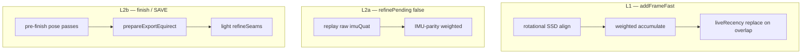

# Sphere stitching agent skill

## Native stack

- **JNI:** `app/src/robotics/cpp/panorama/sphere_jni.cpp`
- **Kotlin facade:** `app/src/robotics/java/ab/inque/robotics/panorama/SphereNative.kt`
- **Operations wrapper:** `SphereStitchOperations.kt` / `SphereNativeOperations`

## Three stitch paths (do not conflate)

## Policy knobs (`SphereRefinePolicy.kt`)

| Flag | Default | Effect |
|------|---------|--------|
| `preferFastFinishExport` | `false` | If true, low-quality fast export on DONE |
| `refreshViewerAfterBackgroundFinish` | `false` | Viewer not updated after L3 polish |
| `runBackgroundGlobalPose` | `false` | No global pose in post-SAVE background |
| `useCenterSquareStitch` | `true` | Live capture crops center square |
| `shouldRunPeriodicRefine` | every 6 frames | Mid-capture L2 when idle |

## Quality gates (E2E / debug)

| Gate | Threshold | Used in |
|------|-----------|---------|
| `minFastRefineCorrelation` | 0.88 | R1 |
| `maxGlobalRefineGhostDelta` | 0.12 | Stripe synth global |
| `maxFinishExportGhostDelta` | 0.05 | Real-world finish |
| `minFinishVsPreviewCorrelation` | 0.75 | `SphereFinishE2ETest` |
| `minFinishOverlapBandCorrelation` | 0.90 | Real-world / debug replay |

Production SAVE does **not** enforce gates — only debug replay dialog (gap S39).

## Export entry points

| Caller | Method |
|--------|--------|
| Live SAVE | `SphereCaptureController.startBackgroundFullExport` |
| Worker | `SphereStitchWorker.runFinishGeneration` |
| Pipeline | `SphereProductionStitchPipeline.runFinishExport` |
| Debug | `SphereDebugSessionReplayer.replay` |

All production paths must call `SphereProductionStitchPipeline.runFinishExport`.

## Common failure modes

| Symptom | Likely cause | Check |
|---------|--------------|-------|
| "can't export" / null equirect | Session reset before export | `onSphereCleanup`, `resetSession` timing |
| Preview good, SAVE bad | L2b global shift vs L1 | S17, pre-finish drain |
| Live worse than roundtrip | `useCenterSquareStitch`, IMU sync | planar script vs device |
| Second pass worse overlap | Inline exposure in rebuild loop | S12 — use `refineSeams` post-rebuild |
| Emulator OOM | 2048+ class run | Per-method instrumentation |

## Files to read before editing

1. `SphereProductionStitchPipeline.kt`
2. `SphereStitchWorker.kt` — scheduling only
3. `SphereRefinePolicy.kt` — thresholds
4. `sphere_jni.cpp` — `processFrameLocked`, `nativeRefinePending`, `globalRefinePosesLocked`

See [FIXES.md](FIXES.md) for lifecycle fixes and [../prismai/GAPS.md](../prismai/GAPS.md) for backlog.
