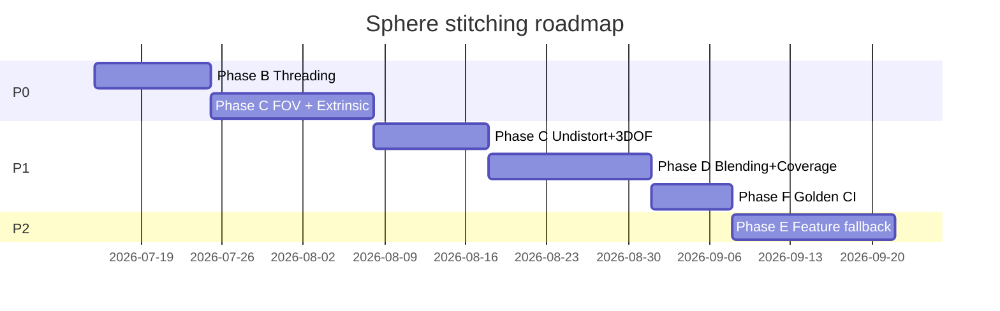

# 360° Sphere Stitching — Feature Plan

**Version:** 1.0  
**Status:** Active  
**Related:** [SPHERE_GAPS.md](SPHERE_GAPS.md) · [SPHERE_TEST_PLAN.md](SPHERE_TEST_PLAN.md)

This plan maps every identified stitching gap (S1–S13) to concrete features, deliverables, and acceptance criteria. Work is ordered by dependency and ROI.

---

## Executive summary

| Phase | Theme | Gaps addressed | Est. effort |
|-------|--------|----------------|-------------|
| **A** ✅ | Testability foundation | S13 (partial) | Done |
| **B** ✅ | Threading & capture timing | S5, S6, S11 | Done |
| **C** ✅ | Geometry & calibration | S1, S2, S3, S4, S10 | Done |
| **D** ✅ | Blending & coverage UX | S7, S9, S12 | Done |
| **E** 🟡 | Advanced alignment & parallax | S8 | Relaxed SSD only |
| **F** ✅ | CI quality gates | S13 (complete) | Done |

**Target outcome:** Tripod slow-pan seam score ≤ 2/5, frame reject rate < 10%, no main-thread JNI, coverage UI matches visible holes.

---

## Gap → feature traceability

| Gap | Feature ID | Feature name | Phase |
|-----|------------|--------------|-------|
| S1 | F-C1 | Lens undistortion pipeline | C |
| S2 | F-C2 | 3-DOF rotational alignment | C |
| S3 | F-C3 | Effective FOV from intrinsics + crop | C |
| S4 | F-C4 | Camera–IMU extrinsic calibration | C |
| S5 | F-B1 | Background stitch worker | B |
| S6 | F-B2 | Adaptive capture throttle | B |
| S7 | F-D1 | Local / tile exposure compensation | D |
| S8 | F-E1 | Feature-based alignment fallback | E |
| S9 | F-D2 | Solid-angle coverage + hole map UI | D |
| S10 | F-C5 | Orientation-aware FOV (replace swap heuristic) | C |
| S11 | F-B3 | Timestamp sync hardening | B |
| S12 | F-D3 | Multiband seam blending | D |
| S13 | F-F1 | Golden-image regression suite | F |

---

## Phase A — Testability foundation ✅

**Goal:** Extract pure Kotlin logic and baseline tests so later refactors are safe.

### Delivered

| Item | Files |
|------|-------|
| Quaternion SLERP / rotate | `QuaternionMath.kt` |
| Pinhole projection mirror of C++ | `SphereProjectionMath.kt` |
| Warning policy | `SphereAlignmentPolicy.kt` |
| Continuous throttle | `SphereCaptureThrottler.kt` |
| Portrait FOV swap (interim) | `SphereFovHelper.kt` |
| GPano XMP export | `SphereXmpMetadata.kt` |
| JVM + instrumented tests | `app/src/test`, `app/src/androidTest` |

---

## Phase B — Threading & capture timing ✅

**Gaps addressed:** S5, S6, S11

| Feature | Status | Files |
|---------|--------|-------|
| F-B1 Background stitch worker | ✅ | `SphereStitchWorker.kt`, `SphereStitchOperations.kt` |
| F-B2 Adaptive capture throttle | ✅ | `SphereAdaptiveThrottler.kt`, `SphereMotionEstimator.kt` |
| F-B3 IMU/camera clock sync | ✅ | `ImuCameraClockSync.kt`, `OrientationQuaternionHistory.kt` |

**Completed:** `SphereCaptureController` enqueues to worker; `PipelineResultDispatcher` uses cached coverage/preview; debug log if stitch runs on main thread.

---

## Phase C — Geometry & calibration ✅

**Gaps addressed:** S1, S2, S3, S4, S10

| Feature | Status | Files |
|---------|--------|-------|
| F-C3/C5 Effective FOV | ✅ | `EffectiveFovCalculator.kt`, `SphereFovHelper.kt` |
| F-C4 IMU extrinsic calibration | ✅ | `SphereExtrinsicCalibration.kt` |
| F-C1 Lens undistortion | ✅ | `LensDistortion.kt`, `sphere_jni.cpp` |
| F-C2 3-DOF alignment (roll) | ✅ | `sphere_jni.cpp`, `FrameAlignmentInfo.rollOffsetDeg` |

---

## Phase D — Blending & coverage UX

**Gaps:** S7, S9, S12  
**Priority:** P1 — visible quality polish.

### F-D1 — Local exposure compensation

**Problem:** S7 — global RGB gain leaves brightness seams.

**Tasks:**

1. Replace global gain with 8×8 tile gain map in overlap region.
2. Smooth tile boundaries (bilinear gain field).
3. Clamp per-tile gain to [0.5, 2.0].

**Acceptance criteria:**

- [ ] Synthetic two-frame test with 30% brightness delta: seam ΔL* < 5 in overlap strip.

---

### F-D3 — Multiband seam blending

**Problem:** S12 — hard splat edges.

**Tasks:**

1. On splat, compute distance-to-seam weight in overlap (feather 16 px in equirect space).
2. Optional v2: Laplacian pyramid blend for export-quality pass on `finishCapture` only (background).

**Acceptance criteria:**

- [ ] High-contrast edge crossing seam: ghosting score ≤ 2/5 subjective.
- [ ] Export time increase < 2 s for 4096×2048.

---

### F-D2 — Solid-angle coverage + hole map

**Problem:** S9 — pixel weight fraction misleads users.

**Tasks:**

1. Add `nativeGetCoverageSolidAngle()` — sample equirect on 32×16 grid; count cells with weight > ε.
2. Add `nativeGetHoleMask()` — downscaled bitmask for UI overlay.
3. `SphereSessionController` — draw hole hints on `spherePreviewImage` (red tint).
4. Block “Finish” if solid-angle coverage < 85% (configurable).

**Acceptance criteria:**

- [ ] Deliberate 90° gap in capture → hole map shows wedge; pixel coverage may still read > 70%.
- [ ] Unit test: mock weight buffer → solid angle matches hand calculation.

**Files:** `sphere_jni.cpp`, `SphereCaptureController`, layout overlay.

---

## Phase E — Advanced alignment & parallax

**Gap:** S8  
**Priority:** P2 — indoor / close-range scenes.

### F-E1 — Feature-based alignment fallback

**When:** IMU + rotational SSD rejects frame (`wasRejected` or `residualSSD > threshold`).

**Tasks:**

1. Extract ORB/SIFT keypoints in overlap region (OpenCV Android SDK or lightweight custom).
2. Estimate homography / essential matrix between overlap patches.
3. Refine quaternion delta; if inlier ratio > 60%, accept frame.
4. Guard: max 100 ms fallback budget on worker thread.

**Acceptance criteria:**

- [ ] Indoor close-range scene: reject rate drops 30% vs IMU-only.
- [ ] Outdoor infinity scene: no regression (fallback rarely triggers).

**Dependency:** Phase B worker (must not block UI).

---

## Phase F — CI quality gates

**Gap:** S13  
**Priority:** P1 — prevent regressions.

### F-F1 — Golden-image regression suite

**Tasks:**

1. Add `app/src/androidTest/assets/sphere/` — 6 synthetic frames (320×240 PNG) + quaternions JSON.
2. `SphereGoldenImageTest` — stitch → downscale 512×256 → SHA-256 hash compare (tolerance: per-pixel ΔRGB ≤ 2).
3. Firebase Test Lab or self-hosted ARM runner in GitHub Actions for `connectedAndroidTest` on `main` + release branches.
4. Document baseline update process in TEST_PLAN.

**Acceptance criteria:**

- [ ] CI fails on intentional 1-pixel projection change until baseline updated.
- [ ] Golden test runs on ARM CI within 5 min.

---

## Implementation order (recommended)

**Critical path:** B1 → B2 → C3/C5 → C4 → C2 → D3 → F1.

---

## Risk register

| Risk | Mitigation |
|------|------------|
| OpenCV APK size | Optional module; feature fallback behind flag |
| Device-specific distortion | Start with zero coeffs; per-device JSON overrides |
| Golden test flakiness | Downscale + tolerance; run on fixed API 34 emulator image |
| Worker queue memory | Single pending frame; recycle bitmaps explicitly |

---

## Definition of done (whole initiative)

- [ ] All S1–S13 gaps have a shipped feature or documented deferral
- [ ] [SPHERE_TEST_PLAN.md](SPHERE_TEST_PLAN.md) coverage matrix all green for P0/P1
- [ ] Manual release checklist passed on 2+ physical devices
- [ ] No `addFrame` on main thread
- [ ] User-facing seam quality ≤ 2/5 on standard QA scene
