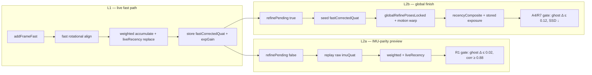

# 360° Sphere Stitching — Gaps & Feature Plan

**Product:** PRISM AI (`VisionMode.SPHERE`)  
**Stack:** CameraX → `VisionAnalysisPipeline` (raw bitmap) → `PipelineResultDispatcher` → `SphereCaptureController` → `SphereStitchWorker` → `SphereNative` / `sphere_jni.cpp` (4096×2048 equirect, IMU quaternions, rotational SSD alignment)

**Last reviewed:** 2026-07-26 (gap-closure pass — synced with [../skills/prismai/GAPS.md](../skills/prismai/GAPS.md))

**Agent skill (three-layer gaps):** [../skills/prismai/GAPS.md](../skills/prismai/GAPS.md) — stitching S1–S35, lifecycle/export S36–S45, CI S46–S50

---

## Problem statement

Users report poor 360° stitching: seams, ghosting, misalignment, gaps in coverage, washed/muddy overlap, and “wobbly” panoramas when panning during continuous capture. Phases A–F addressed threading, geometry, exposure seams, coverage UX, and CI regression — but photorealistic quality on close subjects, handheld translation, and high-contrast seams still lags desktop stitchers. **Phase G** targets non-pinhole camera models, inter-frame motion, and warp-field stitching (see linked plan).

---

## Gap status (S1–S13)

| ID | Gap | Status | Impact / notes | Key files |
|----|-----|--------|----------------|-----------|
| S1 | **Pinhole projection only** | ✅ Done | `LensDistortionStore` + per-device k1 profiles | `LensDistortionStore.kt` |
| S2 | **2-DOF alignment** | ✅ Done | Roll search ±5° in native SSD | `sphere_jni.cpp` |
| S3 | **FOV mismatch** | ✅ Done | Analysis size + sensor FOV | `EffectiveFovCalculator.kt` |
| S4 | **No camera–IMU extrinsic** | ✅ Done | Persistent offset quaternion; limited calibrate UX | `SphereExtrinsicCalibration.kt` |
| S5 | **Native `addFrame` on main thread** | ✅ Done | Single-frame queue, drop-if-busy | `SphereStitchWorker.kt` |
| S6 | **5 fps continuous throttle** | ✅ Done | Adaptive throttle from angular velocity | `SphereAdaptiveThrottler.kt` |
| S7 | **Global per-channel gain only** | ✅ Done | 8×8 tile gain + bilinear field | `TileGainMap.kt`, `sphere_jni.cpp` |
| S8 | **Parallax not handled** | 🟡 Partial | Micro-shift ±10 px + relaxed SSD; no ORB | `sphere_jni.cpp`, `SphereAlignmentFallback.kt` |
| S9 | **Coverage = weighted pixel fraction** | ✅ Done | Solid-angle grid + hole mask + dual HUD | `SolidAngleCoverage.kt`, `SphereCoverageFormatter.kt` |
| S10 | **Portrait FOV swap heuristic** | ✅ Done | Aspect-ratio calculator | `EffectiveFovCalculator.kt` |
| S11 | **Pipeline lag vs IMU timestamp** | ✅ Done | Clock sync + quaternion history | `ImuCameraClockSync.kt`, `OrientationTracker.kt` |
| S12 | **No seam blending / multiband** | 🟡 Partial | Overlap exposure norm (median + per-channel) + tile gain seeding + multiband in `refineSeamsLocked`; export still skips seam pass (S23) | `sphere_jni.cpp` `applyOverlapExposureNormalization`, `refineSeamsMultibandPassLocked` |
| S13 | **No golden-image regression** | ✅ Done | ARM CI + checksum test | `SphereGoldenImageTest.kt`, `android-sphere-e2e.yml` |
| S14 | **Forward splat only (no inverse spherical map)** | 🟡 Partial | `addFrame` uses inverse equirect→ray→frame; refine rebuild uses forward splat + replace-on-overlap; fast path forward | `sphere_jni.cpp` `splatFrameInverseSpherical` |
| S15 | **Fast/refine warp ray inconsistency** | 🟡 Partial | Refine rebuild no longer refits warp (G0); fast path still tx-warp; preview vs refine geometry differs | `sphere_jni.cpp` |
| S16 | **No cos(lat) solid-angle splat weight** | 🟡 Partial | `splatPixel` scales weight by cos(lat) | `sphere_jni.cpp` |
| S17 | **Fast vs refine dual stitch models** | 🟡 Partial | L1 weighted accumulate + `liveRecency` replace; L2 global recency replay + stored exposure; IMU-parity L2 matches L1 (R1 correlation=1.0) but global finish shifts composite (ghost Δ≈0.12) | `sphere_jni.cpp`, `SphereRefinePolicy.kt` |
| S18 | **`refined=true` freezes re-align** | 🟡 Partial | `REALIGN_WINDOW=40` locks old frames; `anyDirty` only when `!refined` — global pose skipped if all frames marked refined | `sphere_jni.cpp` `nativeRefinePending` |
| S19 | **Rotational SSD over-fit on repeated texture** | 🟡 Partial | Global pairwise SSD still texture-sensitive; no IMU prior λ (S28) | `globalRefinePosesLocked` |
| S20 | **Fast→refine warp seed** | 🟡 Superseded | `estimatePerCellWarp` seeds from fast warp when `doAlign`; refine path uses G0 pose + identity warp instead | `sphere_jni.cpp` A4 |
| S21 | **Translation-only warp for rotation overlap** | 🟡 Partial | Fast path only; refine no longer uses per-cell warp | `sphere_jni.cpp` |
| S22 | **Inverse splat not on refine rebuild** | 🟡 Partial | Refine rebuild uses inverse splat + replace-on-overlap (G2) | `splatFrameInverseSpherical` |
| S23 | **Export vs preview seam treatment** | 🟡 Partial | `runFinishGeneration` skips `refineSeams`; export can differ from last refined preview | `SphereStitchWorker.kt` |
| S24 | **Refine overlap E2E suite** | 🟡 Partial | R1–R4, R6, R7 implemented + gated; R5 periodic mid-capture open; run per-method on ARM (OOM at 2048×1024 class run) | `SphereRefineOverlapE2ETest.kt`, `SphereRefinePolicy.kt` |
| S25 | **Perf / reject telemetry** | ❌ Open | Success table targets (p95 latency, reject rate) not logged or gated in CI | `SpherePerfE2ETest`, logcat only |
| S26 | **Greedy align vs accumulator** | 🟡 Partial | G0 global pairwise ray-space pose refine (2-pass chain); not full pose-graph BA | `SPHERE_GLOBAL_STITCH_PLAN.md` |
| S27 | **Chain-only global pose** | 🟡 Partial | Neighbors i−3..i−1 and i+1 in pairwise SSD; not full pose graph | `globalRefinePosesLocked` |
| S28 | **No IMU prior in global cost** | 🟡 Partial | λ‖δR‖² penalty vs capture-time `imuQuat` (λ=40) | `refineFramePoseGlobal` |
| S29 | **Winner-take-pixel composite** | 🟡 Partial | `liveRecency` unified for L1 + IMU-parity L2; global L2 uses `recencyComposite=true` + stored exposure; fast path still weighted outside overlap replace | `sphere_jni.cpp` `processFrameLocked` |
| S30 | **Close-subject parallax** | 🟡 Partial | Depth-weighted warp retained on refine; `SphereMotionDepthEstimator` async MiDaS refresh (gradient immediate) | `SphereMotionDepthEstimator.kt`, `sphere_jni.cpp` |
| S31 | **Lens profiles unused** | 🟡 Partial | S1 store exists; session still passes `LensDistortion.NONE` by default | `LensDistortionStore.kt` |
| S32 | **Refine skipped when all `refined`** | 🟡 Partial | Re-runs when frame count grows since last refine; idle no-op when unchanged | `nativeRefinePending` |
| S33 | **E2E memory / suite isolation** | 🟡 Partial | Per-method instrumentation required; `force-stop` between tests; emulator often lacks storage for main APK | ARM CI, OnePlus A6013 |
| S34 | **Joint intrinsics + overlap ground minimization** | 🟡 Partial (I0–I2) | Overlap bank + focal/k1 refine; k1 persisted on finish; Camera2 K₀ (I3) pending — see [SPHERE_INTRINSIC_OVERLAP_PLAN.md](SPHERE_INTRINSIC_OVERLAP_PLAN.md) | `sphere_jni.cpp`, `LensDistortionStore.kt` |
| S35 | **Dual quality metrics (ghost vs SSD)** | 🟡 Partial | Global refine lowers overlap SSD but raises equirect ghost on stripes; separate policy gates codified (0.02 vs 0.12) — product UX for preview≠finish not resolved | `SphereRefinePolicy.kt`, sprint analysis §2026-07-21 |
| S36 | **Overlap bank rebuild after global pose** | 🟡 Partial | Rebuild hook when `refinedQuat` moves | `sphere_jni.cpp` |
| S37 | **Stale L2/L3 callback invalidation** | 🟡 Partial | `refinementGeneration` bump on resume/finish; needs instrumented test | `SphereStitchWorker.kt` |
| S38 | **Finish E2E on stripe synth** | 🟡 Partial | `SphereFinishE2ETest` corr gate fails on emulator (~0.54 vs 0.75) | `SphereFinishE2ETest.kt` |
| S39 | **Runtime quality gate on production SAVE** | ✅ Done | `SphereExportQualityGate` in `attemptSaveEquirectangular`; E2E `SphereExportQualityGateE2ETest` | `SphereSessionController.kt` |
| S40 | **`refreshViewerAfterBackgroundFinish`** | ❌ Open | Policy `false` — viewer not updated after L3 polish | `SphereRefinePolicy.kt` |
| S41 | **`runBackgroundGlobalPose`** | ❌ Open | Policy `false` — limited post-SAVE background refine | `SphereRefinePolicy.kt` |
| S42 | **Process death during background SAVE** | ❌ Open | `pendingBackgroundSave` not persisted | `SphereSessionController.kt` |
| S43 | **Export progress UI** | ✅ Done | `SphereExportNotificationHelper.showExportProgress` during `runFinishGeneration` | `SphereExportNotificationHelper.kt` |
| S44 | **L1 depth heuristic only** | 🟡 Partial | Gradient on stitch thread; MiDaS async via `SphereMotionDepthEstimator.scheduleMiDaSRefresh` | `SphereMotionDepthEstimator.kt` |
| S45 | **Preview 1024² vs export 4096²** | 🟡 By design | Pre-finish drain on DONE; UX does not explain delta | `SphereCaptureController.kt` |
| S46 | **CI omits save E2E classes** | ✅ Done | 9 classes in `android-sphere-e2e.yml` incl. save + quality gate | `.github/workflows/android-sphere-e2e.yml` |
| S47 | **Planar production replay on emulator** | 🟡 Partial | `assumeFalse` skip on emulator for production replay | `SpherePlanarReplayE2ETest.kt` |
| S48 | **Emulator install/storage flakes** | 🟡 Partial | `adb shell pm trim-caches` in CI workflow | CI / local |
| S49 | **Worker shutdown race test** | ✅ Done | `SphereWorkerShutdownE2ETest` | `SphereStitchWorker.kt` |
| S50 | **`useCenterSquareStitch` live-only** | 🟡 Partial | Planar E2E uses full frame — geometry mismatch | `SphereRefinePolicy.kt` |

**Legend:** ✅ shipped · 🟡 partial / lite · ❌ open

---

## Critical refine/overlap sprint — deep analysis (2026-07-20 → 2026-07-21)

This section records what was attempted in the critical-priority overlap/refine work, what was reverted, empirical findings on device, and what should happen next. It supersedes the older S17–S33 bullet notes below.

### Context

Users report overlap getting **worse after the second pass** (refine/finish). The sprint targeted S12 (exposure/seams), S17/S29 (dual compositing models), S24 (E2E gates), and the R1 regression that blocked shipping IMU-parity preview refine.

### Architecture: two refine modes (must not conflate)



| Mode | JNI flag | Quaternion seed | Compositing | Exposure | Quality metric |
|------|----------|-----------------|-------------|----------|----------------|
| **L1 live** | `addFrameFast` | IMU + fast align | weighted + `liveRecency` replace on overlap | per-frame median + tile gains | live preview |
| **L2a preview** | `refinePending(false)` | raw `imuQuat` | same as L1 (`liveRecency`) | recomputed live | ghost Δ ≤ **0.02**, correlation ≥ **0.88** (R1) |
| **L2b finish** | `refinePending(true)` | `fastCorrectedQuat` | `recencyComposite` replace | **stored** `expGainR/G/B` | overlap SSD ↓, ghost Δ ≤ **0.12** (A4/R7) |

**Key insight:** IMU-parity and global finish optimize **different objectives**. Passing R1 does not imply passing A4, and vice versa. Tests that mixed gates (e.g. R2/R7 initially using `maxGhostRegression()` on global refine) were false failures.

---

### What was tried and shipped

| Change | Gap | Result | Evidence |
|--------|-----|--------|----------|
| **Unified `liveRecency`** — replace-on-overlap for L1 *and* IMU-parity L2 replay (not only when `allowReject`) | S17, S29 | ✅ Fixed R1 ghost Δ ~0.35 → **0.0** | OnePlus: R1 `ghostFast=ghostRefined=0.162`, `correlation=1.0` |
| **`fastCorrectedQuat` in `StoredFrame`** — global L2 seeds from capture-time correction; L2a resets to raw IMU | S18, S20 | ✅ R1 safe; global pose uses corrected geometry | `storeFrameForRefine`, `nativeRefinePending` |
| **Overlap exposure normalization** — median luminance + per-channel match in overlap band; tile gains seeded from global gain | S12 | ✅ E1 passes | `applyOverlapExposureNormalization` |
| **Multiband seam pass** inside `refineSeamsLocked` | S12 | ✅ E2 sharpness retained | `refineSeamsMultibandPassLocked` |
| **Stored exposure gains** on `StoredFrame`; forced only when `recencyComposite=true` | S12, S17 | ✅ E4 passes | `rebuildEquirectFromStoredFramesLocked` |
| **Dual policy gates** in `SphereRefinePolicy` | S24 | ✅ Documented thresholds | `maxGhostRegression=0.02`, `maxGlobalRefineGhostDelta=0.12` |
| **E2E suite R1–R4, R6, R7** + alignment A1–A4 + exposure E1–E4 | S24 | ✅ Per-method on OnePlus | `SphereRefineOverlapE2ETest`, `SphereAlignmentE2ETest`, `SphereExposureSeamE2ETest` |
| **JVM policy/metrics tests** | S24 | ✅ | `SphereRefinePolicyTest`, overlap metrics tests |

---

### What was tried and reverted (do not re-land without new design)

| Attempt | Why it failed | Lesson |
|---------|---------------|--------|
| **`refineSeamsPassLocked` immediately after `nativeRefinePending(true)`** | Broke R1 and alignment tests | Post-global seam/exposure must be an **isolated band-limited pass**, not inline in rebuild |
| **Stored exposure gains on IMU-parity replay** (`recencyComposite=false`) | Gains tied to capture-time quat geometry; replay uses different poses | Stored gains are **finish-only** artifacts |
| **Tile accumulation init to `gainR` globally** | Broke R1 ghost/correlation | Tile path must branch: stored-exposure splat only when `useStoredExposure` |
| **R4: full-equirect correlation between 4-frame and 8-frame snapshots** | Correlation ~0.66 — content region grew, not a seam bug | Multi-refine needs **yaw-band** or overlap-region metric, not whole-image correlation |
| **R2/R7: `applyGlobalPose=true` + `maxGhostRegression(0.02)`** | Ghost Δ ~0.12 on 2-frame stripe; false failure | R2 = IMU-parity; R7/A4 = global gate |
| **R4: `maxAbsoluteGhostAfterRefine(0.08)` on 8-frame global session** | Absolute ghost ~0.26 on synth stripes | Absolute ghost bound only valid for **2-frame** sessions; multi-frame needs delta-only |

---

### Empirical findings (OnePlus, 2048×1024, vertical-stripe synth)

| Observation | Value | Implication |
|-------------|-------|-------------|
| IMU-parity refine on 2 shifted frames | ghost Δ **0.0**, correlation **1.0** | L2a is a true no-op rebuild when fast path already correct — **R1 is the right preview gate** |
| Global refine on same 2 frames | ghost 0.162 → 0.282, Δ **0.119** | Recency composite **restructures** overlap; SSD improves (G1) but stripe ghost metric worsens |
| Global refine with mismatched shift (6px content, 8px ghost probe) | Δ **0.133** (flaky fail at 0.12) | Test geometry must be **self-consistent** (`SHIFT_DX` everywhere) |
| Multi-refine (4 + 4 frames, two global passes) | ghost Δ between snapshots within 0.12; absolute ghost ~0.26 | R4 should compare **refine-to-refine delta**, not absolute ghost |
| R6 finish seam pass | pre↔post correlation ≥ 0.95 | Multiband seam pass is safe **after** global refine when invoked via `refineSeams()` |
| Full `SphereRefineOverlapE2ETest` class run | Process crash (SIGKILL) | S33: always `force-stop` + per-method; never batch 2048×1024 |
| Emulator | `INSTALL_FAILED_INSUFFICIENT_STORAGE` for main APK | ARM physical device is the reference environment |

**Root cause of “refine made it worse” (updated):** Not primarily pose error — it is **compositing model change** (weighted accumulate → recency replace) plus **different quaternion seeds** (raw IMU vs fast-corrected). Overlap-bank SSD and equirect ghost score are **anti-correlated** on synthetic stripe tests. Product should message: preview refine (L2a) preserves live look; finish (L2b) trades preview parity for global alignment and export quality.

---

### Test matrix (current gates)

| Test | Path | Pass criteria | Status |
|------|------|---------------|--------|
| **R1** | IMU-parity | ghost Δ ≤ 0.02, corr ≥ 0.88 | ✅ |
| **R2** | IMU-parity | no regression + match/improve/bound | ✅ |
| **R3** | global, 4 noisy frames | ghost Δ ≤ 0.02 | ✅ |
| **R4** | global, 8 frames, 2× refine | inter-refine ghost Δ ≤ 0.12, baseline stability | ✅ |
| **R5** | periodic mid-capture | — | ❌ not implemented |
| **R6** | global + `refineSeams()` | pre↔post seam corr ≥ 0.95 | ✅ |
| **R7** | global, 2 frames | ghost Δ ≤ 0.12 (A4 parity) | ✅ |
| **A1–A4** | fast align + preview + global | align SSD, reject, IMU parity, global Δ | ✅ |
| **E1–E4** | exposure + seams + stored gains | luminance, sharpness, R1 w/ fast quat, E4 rebuild | ✅ |
| **G1** | sparse graph | overlap SSD ↓ | ✅ (separate class) |
| **RW1–RW5** | `SphereRealWorldE2ETest` | textured/parallax/AE fixtures; finish ghost Δ ≤ **0.05**; overlap-band corr ≥ **0.90** | 🟡 tight gates — expect fail until L2b soft blend |
| **WF1** | `VisionWorkflowE2ETest` | CameraX capture + sharpness retention ≥ **0.80** | 🟡 device-dependent |

**Still open from [SPHERE_REFINE_OVERLAP_PLAN.md](SPHERE_REFINE_OVERLAP_PLAN.md):** R5 periodic refine, warp-geometry parity hook (original R7 spec). PG-R3 SSD gate ✅ in `SpherePerfE2ETest`.

---

### What was not tried (and should be, prioritized)

| Priority | Item | Gap | Rationale |
|----------|------|-----|-----------|
| **P0** | **Band-limited post-global exposure + seam** without touching rebuild loop | S12, S23 | `refineSeams()` after global works (R6); inline pass does not. Wire into `runFinishGeneration` only. |
| **P0** | **Unify compositing OR accept dual UX** | S17 | Either make L1 use recency on overlap (preview jump risk) or document that finish will look different from last live frame |
| **P1** | **Yaw-band boundary metric for R4** | S24 | Replace delta-only with overlap-band correlation at frame 4/5 seam |
| **P1** | **R5 + re-enable periodic refine with policy** | S32, S24 | `shouldRunPeriodicRefine` hardcoded `false` — needs jump-free L2a-only periodic pass |
| **P1** | **PG-R3 / S25 telemetry** | S25 | Log p95 `addFrame`, reject rate, refine SSD before/after; gate in `SpherePerfE2ETest` |
| **P2** | **Full pose graph BA** | S27 | Chain neighbors still drift on long sessions |
| **P2** | **Parallax / 6-DoF on close subjects** | S30 | Global rotation-only fails on translated overlap (G2/G5) |
| **P2** | **Lens profiles at session start** | S31 | `LensDistortion.NONE` default undermines S34 |
| **P3** | **Lower-res E2E fixture (1024×512)** for CI class runs | S33 | Avoid OOM without losing native path coverage |

### Recommended agent workflow after this sprint

1. **Never regress R1** — any native change must run `fastRefine_noRegression` first.
2. **Global/finish changes** — run A4 + R7 + G1 SSD, not R1.
3. **Exposure/seam changes** — run E1–E4 + R6; do not inline into `nativeRefinePending` rebuild.
4. **Policy changes** — update `SphereRefinePolicy.kt` + `SphereRefinePolicyTest` together.
5. **Docs** — mirror threshold changes in [docs/skills/prismai/GAPS.md](../skills/prismai/GAPS.md).

---

### S17–S33 notes (2026-07-20, historical)

- **G0 global pose (S26):** `refinePending` runs `globalRefinePosesLocked()` (pairwise ray SSD, 2 passes) then splats with `doAlign=false` and identity warp. Replaces per-frame greedy align-to-accumulator on refine.
- **S20 superseded on refine:** Warp seed still exists in `estimatePerCellWarp(recencyComposite)` but refine no longer runs per-cell warp; parity test moved to `globalPose_refineImprovesOverlap` (R7).
- **Still broken for users:** Live fast path is still greedy + weighted blend (S17, S29). Global finish shifts composite vs preview (ghost Δ≈0.12) even when SSD improves — see sprint analysis above.
- **Refine may no-op (S32):** After first refine all frames `refined=true`; periodic refine at frame 6 returns early unless new unrefined frames arrive.
- **Root cause of “second pass broke overlap” (historical):** See [SPHERE_REFINE_OVERLAP_PLAN.md](SPHERE_REFINE_OVERLAP_PLAN.md). Mitigated for ghost; preview jump/blur remains (S17).
- **Inverse splat regression:** Full inverse splat on refine caused holes/sharpness loss. Hybrid: inverse on `addFrame` only; refine uses forward splat + replace.
- **Worker lifecycle:** `RejectedExecutionException` if `shutdown()` races periodic refine — guard via `safeExecute`; needs instrumented test.
- **Next quality tier:** [SPHERE_INTRINSIC_OVERLAP_PLAN.md](SPHERE_INTRINSIC_OVERLAP_PLAN.md) (S34 overlap bank + joint K,D,R), [SPHERE_GLOBAL_STITCH_PLAN.md](SPHERE_GLOBAL_STITCH_PLAN.md) G1 pose graph, G2 winner composite, G5 depth parallax.

---

## Recently resolved (not in S-table)

| Issue | Fix |
|-------|-----|
| Live preview stale after stitch | `SpherePreviewBinder` + apply on `onCoverageUpdate` and stitch complete |
| Photo mode waited for next pipeline frame | `lastRawFrame` + immediate capture in `SphereSessionController` |
| Worker dropped frames while busy | Single pending frame queue |
| Hole overlay PorterDuff SCREEN unreliable | Alpha composite in `SphereHoleOverlay` |
| **SAVE wiped native session before export** | Export starts before UI dismiss; `release()` not `resetSession` on mode switch; session retained during background export |
| **Double SAVE dropped callback** | Queued callbacks in `SphereCaptureController` |
| **SAVE before DONE** | `State.PREVIEW` guard; capture-bar SAVE hidden |
| **Debug replay ≠ production SAVE** | `SphereDebugSessionReplayer` uses `SphereProductionStitchPipeline` |

Tests: `SpherePreviewIntegrationTest`, `SphereSessionControllerPreviewTest`, `SphereSessionControllerSaveTest`, `SphereSaveExportE2ETest`.

Details: [../skills/sphere-stitching/FIXES.md](../skills/sphere-stitching/FIXES.md).

---

## Phased delivery status

| Phase | Gaps | Status |
|-------|------|--------|
| A — Testability | helpers, baseline e2e | ✅ |
| B — Threading & timing | S5, S6, S11 | ✅ |
| C — Geometry & calibration | S1–S4, S10 | ✅ (S1 coeffs default zero) |
| D — Blending & coverage | S7, S9, S12 | 🟡 S12 seam refine on export |
| E — Advanced alignment | S8 | 🟡 micro-shift + SSD fallback |
| F — CI & golden assets | S13 | ✅ |
| **G — Non-pinhole & motion** | S1, S8, S12, S14–S33 | 🟡 In progress | G0 global pose + overlap E2E; pose graph + winner composite open |

> Implementation detail: [SPHERE_FEATURE_PLAN.md](SPHERE_FEATURE_PLAN.md) · Verification: [SPHERE_TEST_PLAN.md](SPHERE_TEST_PLAN.md) · **Phase G:** [SPHERE_NON_PINHOLE_MOTION_PLAN.md](SPHERE_NON_PINHOLE_MOTION_PLAN.md) · **Refine overlap:** [SPHERE_REFINE_OVERLAP_PLAN.md](SPHERE_REFINE_OVERLAP_PLAN.md) · **Global stitch:** [SPHERE_GLOBAL_STITCH_PLAN.md](SPHERE_GLOBAL_STITCH_PLAN.md)

---

## Success criteria

| Metric | Target | Current |
|--------|--------|---------|
| Seam visibility (subjective 1–5) | ≤ 2 on tripod slow pan | Manual QA only |
| Frame reject rate (continuous) | < 10% in normal use | Not instrumented |
| `addFrame` p95 latency | < 50 ms off main thread | Not instrumented |
| Coverage vs visual holes | Holes visible when solid angle low | ✅ hole overlay + 85% gate |
| Unit test count (sphere-related) | ≥ 15 JVM + 5 instrumented | ~60 JVM + 15+ ARM (refine/align/exposure) |
| CI | `./gradlew test` green; sphere e2e on ARM | ✅ JVM 131; ARM on path-filtered PRs |

---

## Architecture reference

```
CameraX ImageAnalysis
  → VisionAnalysisPipeline (SPHERE: raw Bitmap)
  → PipelineResultDispatcher (lastRawFrame, sphere HUD)
  → SphereSessionController / SphereCaptureController
       → OrientationTracker.getQuaternion(At) + extrinsic
       → SphereStitchWorker (executor)
            → SphereNative.addFrame (JNI)
       → SpherePreviewBinder → spherePreviewImage
  → finishCapture → GPano XMP → MediaStore
  → SphereViewerView (rectilinear preview)
```

Native engine (`sphere_jni.cpp` v4): **fast:** sparse overlap → optional global tx warp → forward splat + accumulate → **refine:** `globalRefinePosesLocked` (pairwise ray SSD, chain neighbors) → clear equirect → replay with frozen quaternions, identity warp, replace-on-overlap forward splat → **addFrame (quality):** inverse spherical splat + full rotational align. Coverage: solid-angle grid + hole mask.

---

## Out of scope (for now)

- Body pose / Asense
- SpaceMap3D
- Full PTGui-class offline stitcher on device
- OpenCV in base APK (optional module for S8 full)
