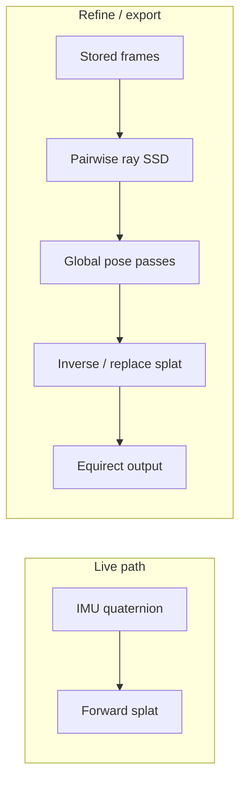

# Global Spherical Stitching — Plan

**Date:** 2026-07-20  
**Status:** Phase G0 implemented (pairwise ray-space pose refine); G1–G3 planned  
**Motivation:** Greedy per-frame alignment against a blended equirect accumulator causes drift, ghosts, and refine “jumps.” Global cost minimization in ray space fixes the root cause.

---

## 1. Why current stitching fails

| Problem | Mechanism |
|---------|-----------|
| **Wrong optimization target** | Each frame minimizes SSD vs **accumulated equirect** (average of all prior frames), not vs true neighbors |
| **Wrong space for cost** | SSD on equirect pixels mixes pole stretch, feather weights, and color averaging |
| **Greedy, not global** | Frame 5 is aligned to a buffer that already contains misaligned frames 1–4 |
| **Dual models** | Fast path (IMU + tx warp) vs refine (clear + replay + rotation + per-cell warp) |
| **Wash-out composite** | Weighted sum `eqR += color * w` averages misaligned layers → muddy ghosts |

IMU gives a good **initial pose graph**. Photometry should **refine the whole graph jointly**, not chase a smeared buffer.

---

## 2. Target: stitch in ray space, minimize global cost

### 2.1 Coordinate spaces

| Space | Role |
|-------|------|
| **Unit sphere S²** (world rays) | Registration — compare what each frame sees along the same direction |
| **Camera plane** | Sampling, optional 2D warp for parallax (later) |
| **Equirect** | **Output only** — render after poses are fixed |

**Rule:** Never align in equirect accumulation buffers. Build correspondences as `(ray ω, color_i, color_j)`.

### 2.2 Global cost function

For frames `i = 0..N-1` with rotations `R_i` (quaternions) and optional small corrections `δR_i`:

```
E = Σ_{(i,j) ∈ overlap_edges}  Σ_{ω ∈ Ω_ij}  ρ( I_i(π_i(ω)) − I_j(π_j(ω)) )
  + λ Σ_i  ||log(δR_i)||²_imu
```

- `π_i(ω)` — project world ray ω into frame i, sample bilinear
- `ρ` — robust kernel (L2 for now, Huber later)
- `λ` — trust IMU prior (keep corrections small)
- **Anchor** frame 0: `δR_0 = 0`

**Solver (mobile tiers):**

| Tier | Algorithm | When |
|------|-----------|------|
| **G0** ✅ | Coordinate descent: 2 passes × N frames, each frame vs neighbors i−1, i−2 | `refinePending` |
| **G1** | Gauss–Newton on `δR_i` (6N−3 DOF) with sparse overlap graph | `finishCapture` |
| **G2** | Add translation `t_i` for parallax (3N DOF, small) | Close subjects |
| **G3** | Per-cell affine warp **after** global rotation settled | Parallax bands |
| **I0–I4** | Overlap bank + joint intrinsics (K, D) with pose in `Ω_ij` | See [SPHERE_INTRINSIC_OVERLAP_PLAN.md](SPHERE_INTRINSIC_OVERLAP_PLAN.md) |

### 2.3 Composite (no wash-out)

After global poses are fixed, render with **winner-take-pixel** or narrow-band Laplacian blend:

```
for each sphere direction ω:
  candidates = frames where π_i(ω) is valid
  pick argmin_i residual_i(ω)   // or graph-cut seam
```

Replace weighted accumulation in overlap (already partial via `replace-on-overlap` on refine).

---

## 3. Architecture

```
addFrameFast
  → IMU splat (live preview, unchanged)
  → store frame + IMU quaternion

refinePending / finishCapture
  → G0 globalRefinePosesLocked()     // pairwise ray SSD, 2 passes
  → clear equirect
  → splat all frames (doAlign=false, identity warp, replace overlap)
  → optional seam blend on export
```



---

## 4. Implementation status

| ID | Item | Status |
|----|------|--------|
| G0a | `pairwiseFrameRaySSD` frame-to-frame | ✅ `sphere_jni.cpp` |
| G0b | `globalRefinePosesLocked` 2-pass coordinate descent | ✅ wired in `nativeRefinePending` |
| G0c | Rebuild with `doAlign=false`, identity warp | ✅ |
| G1 | Sparse pose graph + multi-neighbor edges | ❌ |
| G1 | IMU prior penalty λ | ❌ |
| G2 | Winner-take-pixel composite | 🟡 replace-on-overlap partial |
| G3 | Finish-pass GN solver (< 8 s budget) | ❌ |
| G4 | Cubemap intermediate for pole stability | ❌ optional |
| G5 | Depth-aware parallax | ❌ see NON_PINHOLE plan |

---

## 5. Tests

| Test | Gate |
|------|------|
| `SphereRefineOverlapE2ETest` R1–R3, R7 | No ghost regression; warp parity |
| `SphereGlobalPoseE2ETest` (planned) | Synthetic 4-frame pan: global SSD ↓ ≥ 10% vs greedy |
| Manual | Door frame + poster at 1 m; refine must not shift seams |

---

## 6. Recommended order

1. **G0** — pairwise global pose (shipped)  
2. **G2** — winner composite everywhere on refine  
3. **G1** — multi-neighbor graph + IMU prior on finish  
4. **G3** — per-cell warp only after global rotation converged  
5. **G5** — depth for indoor parallax  

---

## 7. Traceability

| Symptom | Fix |
|---------|-----|
| “Second pass broke it” | G0 global pose before rebuild |
| Periodic ghost spikes | G2 winner composite |
| Close-subject double edges | G3 translation + warp after G1 |
| Pole seams | G4 cubemap or cos(lat) weight (S16) |

Update [SPHERE_GAPS.md](SPHERE_GAPS.md) S26 when G1 lands.
