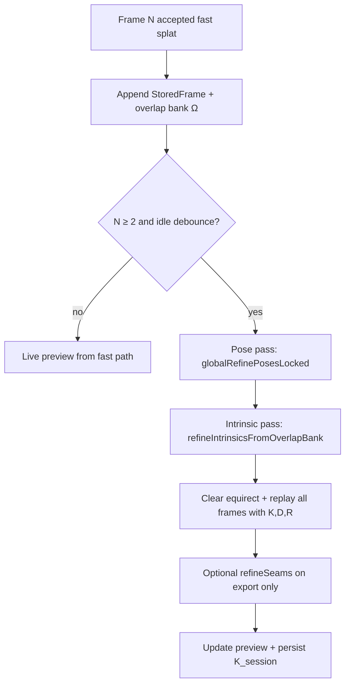

# Spherical Ground Minimization with Joint Intrinsics — Plan

**Date:** 2026-07-20  
**Status:** I0–I2 implemented (2026-07-20); I3–I4 pending  
**Motivation:** Global pose refinement (G0) minimizes photometric error in **ray space**, but pixel→ray mapping still assumes fixed FOV and often **zero distortion**. Wrong intrinsics look like wrong pose: seams at frame edges, ghosting in overlap, and pose-only solvers absorb geometric error as rotation. Overlap regions are where both **poses** and **intrinsics** are jointly observable.

**Related:** [SPHERE_GLOBAL_STITCH_PLAN.md](SPHERE_GLOBAL_STITCH_PLAN.md) (G0 pose) · [SPHERE_REFINE_OVERLAP_PLAN.md](SPHERE_REFINE_OVERLAP_PLAN.md) (fast vs refine regression) · [SPHERE_NON_PINHOLE_MOTION_PLAN.md](SPHERE_NON_PINHOLE_MOTION_PLAN.md) (distortion + parallax) · [SPHERE_GAPS.md](SPHERE_GAPS.md) (S31, S34)

---

## 1. Problem statement

| Issue | Mechanism |
|-------|-----------|
| **Fixed intrinsics** | `storedFovH/V` + implicit principal point at image center; distortion often `LensDistortion.NONE` (S31) |
| **Pose-only ground cost** | `globalRefinePosesLocked` adjusts `R_i` but not `K` or `D` |
| **Intrinsics ↔ pose ambiguity** | A wrong focal length can be partially compensated by rotating frames — overlap SSD drops but geometry is wrong |
| **Overlap data discarded** | `OverlapSample` vectors are ephemeral inside `processFrameLocked`; not accumulated for joint solve |
| **No replay on K change** | When intrinsics update, all frames must re-project; requires full equirect rebuild (already done on `refinePending`) |

**User goal:** After the second overlapping frame, run a **global minimum** in spherical coordinates; **collect overlap regions** across the session; **continuously refine** camera model + poses; **re-stitch all frames** as new images arrive.

---

## 2. Target architecture

### 2.1 Coordinate pipeline (unchanged principle)

| Space | Role |
|-------|------|
| **Unit sphere S²** (world rays ω) | Registration — shared directions in overlap |
| **Camera plane** (u, v) + intrinsics K, D | Sampling via `π(K, D, R_i, ω)` |
| **Equirect** | **Output only** — render after K, D, and all `R_i` are fixed for this iteration |

**Rule:** Ground cost is always evaluated in **ray space** or equivalently via consistent `π`. Never align by smearing an accumulated equirect average.

### 2.2 Joint cost function

For frames `i = 0..N-1`, session intrinsics `(K, D)`, poses `R_i`:

```
E(K, D, {R_i}) =
    Σ_{(i,j) ∈ edges}  Σ_{ω ∈ Ω_ij}  ρ( I_i(π(K,D,R_i,ω)) − I_j(π(K,D,R_j,ω)) )
  + λ_R Σ_i  ||log(R_i · R_imu,i⁻¹)||²
  + λ_K ||K − K₀||²  +  λ_D ||D − D₀||²
```

| Term | Meaning |
|------|---------|
| `Ω_ij` | Overlap correspondence bank — world rays ω where both frames see valid pixels |
| `K₀, D₀` | Prior from Camera2 / `LensDistortionStore` / `EffectiveFovCalculator` |
| `λ_R` | IMU trust (already partial: S28, `IMU_PRIOR_LAMBDA`) |
| `λ_K, λ_D` | **Strong** regularization — intrinsics are slow variables |
| Anchor | Frame 0: `R_0` fixed (or tied to IMU); `K` cannot drift without multi-view constraints |

### 2.3 Continuous capture loop



| Event | Action |
|-------|--------|
| Frame 1 | Fast IMU splat; store frame; no global solve |
| Frame 2+ | Accumulate `Ω_12`, …; debounced **joint refine**; full rebuild |
| Each new frame | Mark pose graph dirty; extend overlap bank; re-minimize E; replay **all** stored frames |
| Finish | Same solver with `applyGlobalPose=true` + `refineSeams()`; persist `K_session` to `LensDistortionStore` |

**Current code (2026-07-20):** G0 pose pass + debounced rebuild after frame 2; **overlap bank (I0)**; **1D focal-scale (I1)** + **k1 (I2)** intrinsic passes in `refinePending(applyGlobalPose=true)`; **k1 persisted to `LensDistortionStore` on finish** via `SphereSessionController`.

---

## 3. Overlap bank (I0)

### 3.1 Data structure

Persist correspondences when frame `j` is accepted and overlaps existing content:

```cpp
struct OverlapCorrespondence {
    int frameI, frameJ;   // stored frame indices
    float wx, wy, wz;   // unit world ray (spherical direction)
    float uI, vI;       // subpixel in frame i
    float uJ, vJ;       // subpixel in frame j (from pairwise ray SSD sampling)
    // optional: uint8_t r,g,b for robust kernel
};

static std::vector<OverlapCorrespondence> sOverlapBank;
```

Populate from:
- Existing `pairwiseFrameRaySSD` sampling grid (step 10)
- Fast-path `OverlapSample` list when `eqWeight > 0` (step 8)

Cap bank size (e.g. 50k entries) with reservoir sampling on oldest pairs if needed.

### 3.2 When to append

| Trigger | Pairs added |
|---------|-------------|
| `addFrameFast` accepted, `sFrameIndex > 0` | `(newFrame, each neighbor k in [i-3..i-1])` |
| After pose refine | Optional: refresh `uJ,vJ` under new `R_j` |

Invalidate bank on `nativeReset()` / session end.

---

## 4. Intrinsic variables (mobile tiers)

### 4.1 Parameterization

| Parameter | Symbol | Default | Search range (initial) |
|-----------|--------|---------|------------------------|
| Focal scale | `f_scale` | 1.0 | [0.95, 1.05] on `tanH`, `tanV` |
| Radial k1 | `k1` | from `LensDistortionStore` | ±0.03 from prior |
| Principal point | `(cx, cy)` | image center | **Fixed** in I1–I2 |
| k2, p1, p2 | — | 0 | **Fixed** until I3+ |

Apply in `pixelToRay` / `worldRayToFramePixel` via existing `undistortNorm` and `storedFovH/V`.

### 4.2 Observability

| DOF | Min. data | Where it shows up |
|-----|-----------|-------------------|
| `R_ij` | 2 frames, overlap | Any textured overlap (G0) |
| `f_scale` | 3+ frames, varied parallax angle | Scale mismatch across wide baseline |
| `k1` | Wide overlap near **frame edges** | Radial seam / barrel mismatch |
| `(cx, cy)` | Strong lines / calibration target | Usually fixed |
| Translation / depth | Close subjects | S30 / G5 — not intrinsics |

**Do not** solve all DOF freely from two frames — always regularize toward `K₀, D₀`.

### 4.3 Intrinsic pass algorithm (I1)

After `globalRefinePosesLocked()`:

```
refineIntrinsicsFromOverlapBank():
  E0 = evalE(K0, D0, {R_i})
  for f_scale in linspace(0.97, 1.03, 7):
    E = evalE(K0 * f_scale, D0, {R_i})
  pick best f_scale; apply if ΔE > threshold and λ_K penalty acceptable
  // I2: 1D golden-section on k1 similarly
  update storedFovH/V or session distK1
```

`evalE` reuses overlap bank only (no full equirect) for speed.

---

## 5. Full replay requirement

Whenever `K`, `D`, or any `R_i` changes:

1. `std::fill` equirect buffers (existing `refinePending`)
2. Replay all `StoredFrame` with `processFrameLocked(..., doAlign=false, recencyComposite=false)`
3. Use **capture-time warps** (`f.warp`) — do not re-fit tx warp during global replay
4. Deliver preview via `SphereStitchWorker.runRefine` → `onCoverageUpdate`

Intrinsics change is **session-global** — one wrong `f_scale` shifts every ray; partial replay is incorrect.

---

## 6. Integration points

| Layer | File | Change |
|-------|------|--------|
| Native bank | `sphere_jni.cpp` | `sOverlapBank`, append on fast accept, `evalE`, `refineIntrinsicsFromOverlapBank` |
| Native refine | `nativeRefinePending` | Call intrinsic pass when `applyGlobalPose=true` and `sFrames.size() >= 2` |
| Session prior | `SphereSessionController.kt` | `lensDistortionStore.get()` — never default to `NONE` if profile exists |
| FOV prior | `EffectiveFovCalculator.kt` + `CameraFovCalculator` | Feed `K₀` (I3) |
| Persist | `LensDistortionStore.kt` | Save converged `k1`, `f_scale` after finish (I2) |
| Worker | `SphereStitchWorker.kt` | Debounced `refinePending(applyGlobalPose=true)` when `frameIndex >= 2` |
| Policy | `SphereRefinePolicy.kt` | Thresholds for intrinsic step acceptance |

### JNI surface (proposed)

| API | Purpose |
|-----|---------|
| `nativeGetSessionFocalScale(): Float` | Debug / telemetry |
| `nativeGetOverlapBankSize(): Int` | Tests |
| `nativeRefinePending(applyGlobalPose: Boolean)` | **Exists** — intrinsic pass runs inside when global |

---

## 7. Implementation phases

| ID | Deliverable | Depends | Risk |
|----|-------------|---------|------|
| **I0** | Overlap correspondence bank | — | Low |
| **I1** | 1D focal scale in global refine + full replay | I0, G0 | Low |
| **I2** | k1 in intrinsic pass; persist to `LensDistortionStore` on finish | I1, S31 | Medium |
| **I3** | Camera2 focal length / sensor size → `K₀` | I1 | Low |
| **I4** | Export-only multi-DOF (k2, weak cx/cy); Huber ρ | I2 | High |

**Out of scope (see other plans):** per-cell parallax warp (G5), full Gauss–Newton pose graph (G1), winner-take-pixel composite (G2).

---

## 8. Tests

### 8.1 Native / JVM

| Test | Gate |
|------|------|
| `OverlapBank_appendsOnSecondFrame` | Bank size > 0 after 2 fast frames |
| `IntrinsicRefine_focalScale_reducesRaySSD` | Synthetic 2% focal mismatch: E drops after I1 |
| `IntrinsicRefine_doesNotDriftWithoutPrior` | Single pair, huge λ_K: f_scale stays 1.0 |

### 8.2 Instrumented (extend existing)

| Test | Gate |
|------|------|
| **I-R1** | 3-frame session: edge seam metric improves after intrinsic pass vs pose-only |
| **I-R2** | `refinePending(false)` vs `true`: correlation ≥ 0.88 on R1; global path improves edge ghost |
| **I-R3** | Finish persists `k1` to store; next session uses prior |

Add `SphereIntrinsicOverlapE2ETest.kt` to `scripts/test.ps1` native suite when I1 lands. **Done** — I0/I1 tests in native suite.

### 8.3 Metrics

| Metric | Use |
|--------|-----|
| `pairwiseRaySSD` (mean over bank) | Intrinsic pass acceptance |
| `edgeBandGhostingScore` | k1 observability |
| `fastRefineCorrelation` | No regression after K update (R1) |

---

## 9. Performance budget

| Step | Target (N ≤ 12 frames, 1920px store) |
|------|--------------------------------------|
| Pose pass (G0) | < 400 ms |
| Intrinsic pass (I1, 7× f_scale) | < 150 ms |
| Full replay splat | < 600 ms |
| **Total debounced refine** | < 1.2 s off main thread |

Run intrinsic pass only on debounce / finish — **never** on fast-path hot loop.

---

## 10. Agent checklist

When implementing this plan:

1. Read [SPHERE_GLOBAL_STITCH_PLAN.md](SPHERE_GLOBAL_STITCH_PLAN.md) G0 — pose pass must stay ray-space, not equirect SSD.
2. Enable `LensDistortionStore.deviceDefault()` in `SphereSessionController.enter()` before I2.
3. Any change to `K` or `D` requires **full** `refinePending` replay.
4. Add overlap bank tests before tuning λ_K.
5. Run `SphereRefineOverlapE2ETest` + `SphereStitchE2ETest#twoPhase_*` after each phase.
6. Document λ values and search ranges in logcat on debug builds.

---

## 11. Gap tracking

Add to [SPHERE_GAPS.md](SPHERE_GAPS.md):

| ID | Gap | Status |
|----|-----|--------|
| **S34** | **Joint intrinsics + pose ground minimization in overlap** | ❌ Open — this plan (I0–I4) |

S31 (profiles unused) is a prerequisite; I2 closes S31 partially.
